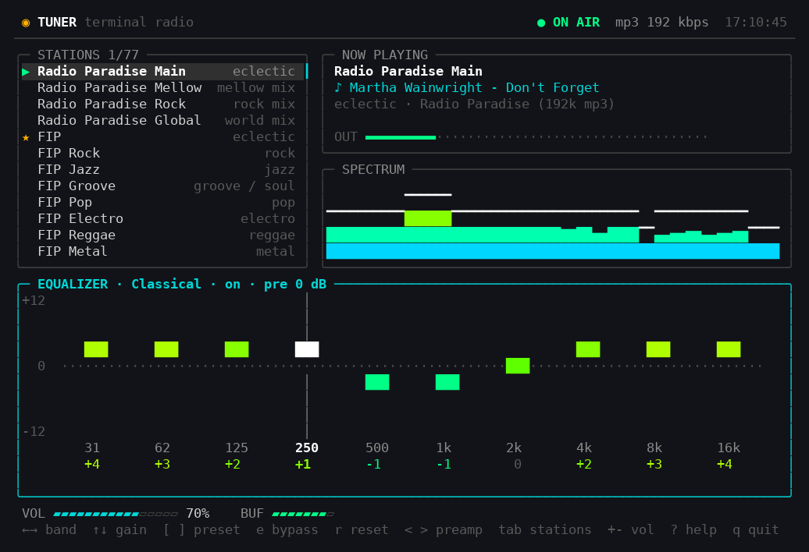

# tuner

Internet radio in a terminal, with a five band equalizer and a set of
audio effects.



ffmpeg decodes the stream; everything after that is plain Java — the filter
bank, the spectrum analyser and the interface. No third party libraries.

**Author:** Claude (Opus 5), written with Claude Code.

## Requirements

- Java 21+
- ffmpeg on `PATH` (or set `TUNER_FFMPEG` to its location)
- a terminal that speaks 256 colours and UTF-8, at least 62x18

## Run it

```bash
./tuner
```

The launcher builds the jar on first run, then starts the app in your terminal.

## Keys

| Stations | |
|---|---|
| `↑` `↓` `j` `k` | move selection |
| `Enter` | tune in |
| `space` | stop / resume |
| `b` `n` | previous / next station, playing immediately |
| `PgUp` `PgDn` `g` `G` | page, top, bottom |
| `/` | filter the list, `esc` clears it |
| `f` | favourite, `s` sorts favourites to the top |
| `a` `d` | add a station, delete one |

| Equalizer (`tab` cycles stations, equalizer, effects) | |
|---|---|
| `←` `→` or `1`-`5` | select a band — the active slider turns white |
| `↑` `↓` | band gain, ±1 dB up to ±12 |
| `[` `]` | cycle presets |
| `e` | bypass the filter bank |
| `r` | back to flat |
| `<` `>` | preamp |

| Effects | |
|---|---|
| `↑` `↓` | select bass, width, surround, crossfeed, reverb or the leveler |
| `space` | toggle the selected effect |
| `←` `→` | bass strength, stereo width, or the reverb room (Room, Club, Hall) |

Surround and crossfeed are headphone effects. Surround already includes a
crossfeed, so that row rests while surround is on.

| Anywhere | |
|---|---|
| `+` `-` | volume |
| `m` | mute |
| `?` | key help |
| `q` | quit |

| Mouse | |
|---|---|
| click | select a station row, or pick an equalizer band |
| click twice | tune in to the row under the pointer |
| click an effect | toggles it |
| wheel | scrolls the list, or adjusts the band, effect or volume under the pointer |
| drag | a slider follows the pointer, even outside its column |

Mouse tracking means the terminal stops handling plain drag-to-select; hold
shift to select text as usual, or start with `--no-mouse` (or `mouse=false` in
the config) to leave the mouse to your terminal entirely.

## Command line

```
tuner --list                 print the stations
tuner --play "FIP Jazz"      tune by name, list number, or stream url
tuner --no-autoplay          do not resume the last station
tuner --no-mouse             leave the mouse to the terminal
```

## Stations

Seventy-seven ship in `stations.tsv`, every url verified against its live stream:

| network | channels |
|---|---|
| [Jazz Radio](https://www.jazzradio.fr/) | 35 — main plus every themed webradio |
| [OUI FM](https://www.ouifm.fr/) | 19 — main plus the rock webradios |
| [FIP](https://www.radiofrance.fr/fip) | 10 — FIP and its sub-channels |
| [BBC](https://www.bbc.com/audio) | 6 — Radio 1, 1Xtra, 2, 3, 3 Unwind, 6 Music |
| [Radio Paradise](https://radioparadise.com/) | 4 — Main, Mellow, Rock, Global |
| [Radio Swiss](https://www.radioswissjazz.ch/) | 3 — Jazz, Classic, Pop |

The OUI FM and BBC urls were resolved through the [radio.net](https://www.radio.es/)
directory API, which lists plain Icecast mounts for the OUI FM webradios and
the BBC's non-UK syndication feeds. The BBC streams are HE-AAC over HLS and
carry no ICY metadata, so they show the station name but no track title.

## Files

The station list lives in the source tree as `stations.tsv` — tab separated,
`name`, `url`, `genre`, `favourite`, with `#` comments. Edit it to change the
defaults everyone gets.

At startup the list is resolved in this order:

| | |
|---|---|
| `$TUNER_STATIONS` | if set, this file is used and written to, nothing else is consulted |
| `~/.config/tuner/stations.tsv` | your own copy, created the first time you add, delete, favourite or sort from inside the app |
| `stations.tsv` in the source tree | the shipped default, found next to the working directory or above the jar |
| `stations.tsv` inside the jar | same file, bundled at build time, so a jar copied elsewhere still has stations |

Edits made in the app always go to the user copy, so the source tree file stays
pristine. Delete `~/.config/tuner/stations.tsv` to go back to the shipped list.
Press `?` in the app to see which file is in use.

Volume, the equalizer curve, the effect settings and the last station are
kept separately in `~/.config/tuner/config.properties`. Both paths honour
`XDG_CONFIG_HOME`. A curve saved by the old ten band equalizer is left
behind and the five band equalizer starts flat.

Any stream url ffmpeg can open works — MP3, AAC, Icecast, Shoutcast or HLS.

## How it works

```
ffmpeg ──PCM s16le──▶ float ──▶ 5-band EQ ──▶ effects ──▶ volume, limiter ──▶ sound card
                                              │                    │
                                              │                    └──▶ spectrum bars
                                              └── bass, width, surround or crossfeed, reverb, leveler
```

The equalizer is a low shelf at 60 Hz, peaks at 230 Hz, 910 Hz and 3.6 kHz,
and a high shelf at 14 kHz. Each band is an RBJ biquad, recalculated when a
slider moves, so changes are audible immediately without re-opening the
stream. The effects are the same chain as aaradio, without mono and without
Android's spatializer. A peak limiter after the volume keeps boosts from clipping.

Track titles come from two places: ffmpeg reports ICY metadata changes, and a
side connection asks the server for the current `StreamTitle` so the first
track of a session shows up too. Dropped streams reconnect with a backoff.

The interface is drawn straight to the terminal: a double buffered cell grid
diffed per row, 256 colour output, raw mode via `stty`, and no curses.

## Layout

```
┌ header ─────────────────────────────────────────┐
│ stations          │ now playing                 │  top half
│                   │ spectrum                    │
├───────────────────┴─────────────────────────────┤
│ equalizer                  │ effects          │  bottom half
├─────────────────────────────────────────────────┤
│ volume · buffer · messages                      │
└ keys ───────────────────────────────────────────┘
```
ffmpeg: for mac

https://deolaha.ca/pub/ffmpeg/